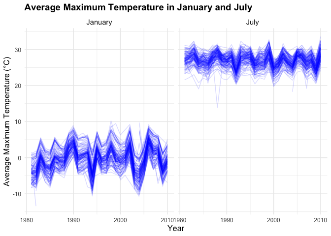
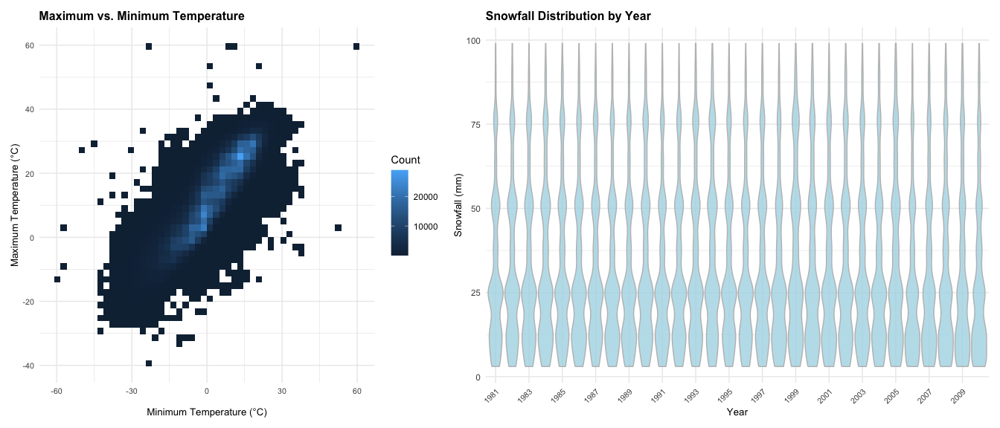
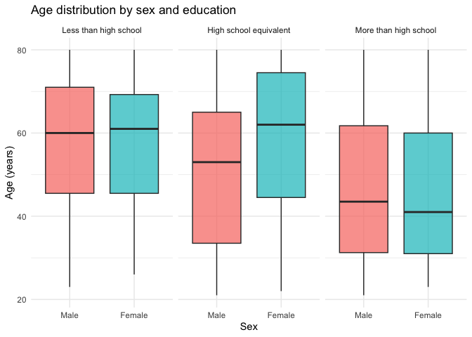
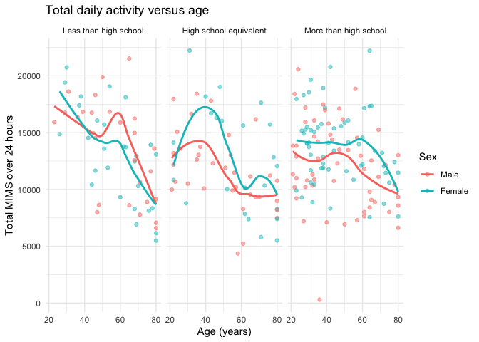
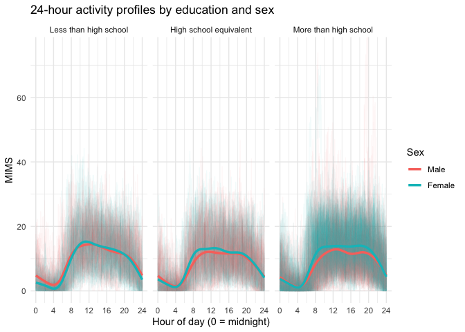

data science Homework 3
================
Yiran Jin
2026-10-13

# Problem 1

``` r
library(p8105.datasets)
library(tidyverse)

data("ny_noaa")

ny_noaa
```

    ## # A tibble: 2,595,176 × 7
    ##    id          date        prcp  snow  snwd tmax  tmin 
    ##    <chr>       <date>     <int> <int> <int> <chr> <chr>
    ##  1 US1NYAB0001 2007-11-01    NA    NA    NA <NA>  <NA> 
    ##  2 US1NYAB0001 2007-11-02    NA    NA    NA <NA>  <NA> 
    ##  3 US1NYAB0001 2007-11-03    NA    NA    NA <NA>  <NA> 
    ##  4 US1NYAB0001 2007-11-04    NA    NA    NA <NA>  <NA> 
    ##  5 US1NYAB0001 2007-11-05    NA    NA    NA <NA>  <NA> 
    ##  6 US1NYAB0001 2007-11-06    NA    NA    NA <NA>  <NA> 
    ##  7 US1NYAB0001 2007-11-07    NA    NA    NA <NA>  <NA> 
    ##  8 US1NYAB0001 2007-11-08    NA    NA    NA <NA>  <NA> 
    ##  9 US1NYAB0001 2007-11-09    NA    NA    NA <NA>  <NA> 
    ## 10 US1NYAB0001 2007-11-10    NA    NA    NA <NA>  <NA> 
    ## # ℹ 2,595,166 more rows

We want to know the size and the structure of the data. \## Overview of
the data

``` r
dim(ny_noaa)
```

    ## [1] 2595176       7

``` r
glimpse(ny_noaa)
```

    ## Rows: 2,595,176
    ## Columns: 7
    ## $ id   <chr> "US1NYAB0001", "US1NYAB0001", "US1NYAB0001", "US1NYAB0001", "US1N…
    ## $ date <date> 2007-11-01, 2007-11-02, 2007-11-03, 2007-11-04, 2007-11-05, 2007…
    ## $ prcp <int> NA, NA, NA, NA, NA, NA, NA, NA, NA, NA, NA, NA, NA, NA, NA, NA, 3…
    ## $ snow <int> NA, NA, NA, NA, NA, NA, NA, NA, NA, NA, NA, NA, NA, NA, NA, NA, 3…
    ## $ snwd <int> NA, NA, NA, NA, NA, NA, NA, NA, NA, NA, NA, NA, NA, NA, NA, NA, 0…
    ## $ tmax <chr> NA, NA, NA, NA, NA, NA, NA, NA, NA, NA, NA, NA, NA, NA, NA, NA, N…
    ## $ tmin <chr> NA, NA, NA, NA, NA, NA, NA, NA, NA, NA, NA, NA, NA, NA, NA, NA, N…

``` r
summary(ny_noaa)
```

    ##       id                 date                 prcp               snow       
    ##  Length:2595176     Min.   :1981-01-01   Min.   :    0.00   Min.   :  -13   
    ##  Class :character   1st Qu.:1988-11-29   1st Qu.:    0.00   1st Qu.:    0   
    ##  Mode  :character   Median :1997-01-21   Median :    0.00   Median :    0   
    ##                     Mean   :1997-01-01   Mean   :   29.82   Mean   :    5   
    ##                     3rd Qu.:2005-09-01   3rd Qu.:   23.00   3rd Qu.:    0   
    ##                     Max.   :2010-12-31   Max.   :22860.00   Max.   :10160   
    ##                                          NA's   :145838     NA's   :381221  
    ##       snwd            tmax               tmin          
    ##  Min.   :   0.0   Length:2595176     Length:2595176    
    ##  1st Qu.:   0.0   Class :character   Class :character  
    ##  Median :   0.0   Mode  :character   Mode  :character  
    ##  Mean   :  37.3                                        
    ##  3rd Qu.:   0.0                                        
    ##  Max.   :9195.0                                        
    ##  NA's   :591786

``` r
ny_noaa |>
  summarise(
    total_rows = n(),
    total_stations = n_distinct(id),
    missing_date = sum(is.na(date)),
    missing_prcp = sum(is.na(prcp)),
    missing_snow = sum(is.na(snow)),
    missing_snwd = sum(is.na(snwd)),
    missing_tmax = sum(is.na(tmax)),
    missing_tmin = sum(is.na(tmin))
  )
```

    ## # A tibble: 1 × 8
    ##   total_rows total_stations missing_date missing_prcp missing_snow missing_snwd
    ##        <int>          <int>        <int>        <int>        <int>        <int>
    ## 1    2595176            747            0       145838       381221       591786
    ## # ℹ 2 more variables: missing_tmax <int>, missing_tmin <int>

**A short description based on the data:** The `ny_noaa` dataset
contains daily weather observations from 2,595,176 records across 747
weather stations in New York State. It has 7 variables, including
station ID (`id`), observation date (`date`), precipitation (`prcp`),
snowfall (`snow`), snow depth (`snwd`), maximum temperature (`tmax`),
and minimum temperature (`tmin`). The observations span from 1981 to
2010. Missing data are an important issue. Precipitation has 145,838
missing values, snowfall has 381,221, and snow depth has 591,786. The
temperature variables (tmax and tmin) are stored as character variables,
and their missing values should also be examined.

## Data Cleaning

``` r
noaa_df =
  ny_noaa |>
  janitor::clean_names() |>
  mutate(
    year = as.numeric(str_sub(date, 1, 4)),
    month = as.numeric(str_sub(date, 6, 7)),
    day = as.numeric(str_sub(date, 9, 10)),
    tmax = as.numeric(tmax) / 10,
    tmin = as.numeric(tmin) / 10,
    prcp = as.numeric(prcp) / 10,
    snow = as.numeric(snow),
    snwd = as.numeric(snwd)
  )
```

Snow falls

``` r
noaa_df |>
  count(snow, sort = TRUE) |>
  slice_head(n = 10)
```

    ## # A tibble: 10 × 2
    ##     snow       n
    ##    <dbl>   <int>
    ##  1     0 2008508
    ##  2    NA  381221
    ##  3    25   31022
    ##  4    13   23095
    ##  5    51   18274
    ##  6    76   10173
    ##  7     8    9962
    ##  8     5    9748
    ##  9    38    9197
    ## 10     3    8790

The most commonly observed snowfall value is expected to be 0 mm because
snowfall does not occur on most observation days.

## Average max temperature in January and in July

``` r
temp_df =
  noaa_df |>
  filter(month %in% c(1, 7)) |>
  group_by(id, year, month) |>
  summarise(
    mean_tmax = mean(tmax, na.rm = TRUE),
    .groups = "drop"
  ) |>
  mutate(
    month = factor(
      month,
      levels = c(1, 7),
      labels = c("January", "July")
    )
  )

ggplot(
  temp_df,
  aes(
    x = year,
    y = mean_tmax,
    group = id
  )
) +
  geom_line(alpha = 0.15, color = "blue") +
  facet_grid(. ~ month) +
  labs(
    title = "Average Maximum Temperature in January and July",
    x = "Year",
    y = "Average Maximum Temperature (°C)"
  ) +
  theme_minimal() +
  theme(
    plot.title = element_text(size = 14, face = "bold"),
    axis.title = element_text(size = 12),
    axis.text = element_text(size = 9),
    strip.text = element_text(size = 11)
  )
```

<!-- -->

**Summary of the plots:** July has much higher average maximum
temperatures (mostly around 25–30°C) than January (mostly around
−5–5°C). There is variation among stations in both months, shown by the
many overlapping lines. January temperatures appear more variable than
July temperatures. There is no obvious long-term increasing or
decreasing trend in either panel. Temperatures fluctuate from year to
year.

Potential outliers: A few stations show unusually low values. In July,
some observations fall well below the main cluster, including one in the
late 1980s. In January, a few observations fall below −10°C.

## tmax vs tmin for the full dataset

``` r
p_temp =
  noaa_df |>
  filter(!is.na(tmax), !is.na(tmin)) |>
  ggplot(aes(x = tmin, y = tmax)) +
  geom_bin2d(bins = 50) +
  labs(
    title = "Maximum vs. Minimum Temperature",
    x = "Minimum Temperature (°C)",
    y = "Maximum Temperature (°C)",
    fill = "Count"
  ) +
  theme_minimal() +
  theme(
    plot.title = element_text(size = 12, face = "bold"),
    axis.title = element_text(size = 10),
    axis.text = element_text(size = 8)
  )
```

## Distribution of snowfall values greater than 0 and less than 100

``` r
p_snow =
  noaa_df |>
  filter(!is.na(snow), snow > 0, snow < 100) |>
  ggplot(aes(x = factor(year), y = snow)) +
  geom_violin(
    fill = "lightblue",
    color = "gray",
    alpha = 0.8,
    scale = "width",
    width = 0.9,
    trim = TRUE
  ) +
  scale_x_discrete(breaks = seq(1981, 2010, by = 2)) +
  labs(
    title = "Snowfall Distribution by Year",
    x = "Year",
    y = "Snowfall (mm)"
  ) +
  theme_minimal() +
  theme(
    plot.title = element_text(size = 12, face = "bold"),
    axis.title = element_text(size = 10),
    axis.text.x = element_text(size = 8, angle = 45, hjust = 1)
  )
```

``` r
library(patchwork)
p_temp + p_snow +
  plot_layout(widths = c(1, 1.5))
```

<!-- -->

**Maximum vs. Minimum Temperature:** The plot shows a positive
association between minimum and maximum temperatures. Days with higher
minimum temperatures generally also have higher maximum temperatures.
Most observations are concentrated in the central region, while a few
extreme values appear to be potential outliers.

**Snowfall Distribution by Year:** The snowfall distributions appear
similar across years, with multiple peaks around certain snowfall
amounts. The distributions are spread across a wide range of snowfall
amounts. Overall, there is no obvious change in the snowfall
distribution over time.

# Problem 2

## Load, tidy, and merge the dataset

``` r
library(tidyverse)
library(janitor)
library(knitr)

covar =
  read_csv("data/nhanes_covar.csv", 
    skip = 4,
    col_names = TRUE,
    na = c("", ".", "NA")) |>
  clean_names()

accel =
  read_csv("data/nhanes_accel.csv", na = c("", ".", "NA"))|>
  clean_names()

covar_tidy <- covar |>
  mutate(
    sex = factor(sex, levels = c(1, 2), labels = c("Male", "Female")),
    education = factor(
      education, levels = c(1, 2, 3),
      labels = c("Less than high school", "High school equivalent", "More than high school"))
  ) |>
  filter(age >= 21) |>
  drop_na()         

nhanes_wide <- inner_join(covar_tidy, accel, by = "seqn") |>
  mutate(seqn = as.character(seqn))     

nhanes_long <- nhanes_wide |>
  pivot_longer(
    cols = starts_with("min"),
    names_to = "minute", names_prefix = "min", values_to = "mims") |>
  mutate(minute = as.integer(minute))

dim(nhanes_wide) 
```

    ## [1]  228 1445

``` r
nhanes_covar_clean =
  covar |>
  filter(
    age >= 21,
    !is.na(age),
    !is.na(sex),
    !is.na(education)
  ) |>
  mutate(
    sex = factor(
      sex,
      levels = c(1, 2),
      labels = c("Male", "Female")
    ),
    education = factor(
      education,
      levels = c(1, 2, 3),
      labels = c(
        "Less than high school",
        "High school equivalent",
        "More than high school"
      ),
      ordered = TRUE
    )
  )
```

## Table for the number of men and women in each education category

## Age distributions for men and women in each education category

``` r
nhanes_wide |>
  count(education, sex) |>
  pivot_wider(names_from = sex, values_from = n, values_fill = 0) |>
  kable(caption = "Number of men and women in each education category",
        col.names = c("Education", "Men", "Women"))
```

    ## Warning in attr(x, "align"): 'xfun::attr()' is deprecated.
    ## Use 'xfun::attr2()' instead.
    ## See help("Deprecated")

    ## Warning in attr(x, "format"): 'xfun::attr()' is deprecated.
    ## Use 'xfun::attr2()' instead.
    ## See help("Deprecated")

| Education              | Men | Women |
|:-----------------------|----:|------:|
| Less than high school  |  27 |    28 |
| High school equivalent |  35 |    23 |
| More than high school  |  56 |    59 |

Number of men and women in each education category

``` r
nhanes_wide |>
  ggplot(aes(x = sex, y = age, fill = sex)) +
  geom_boxplot(alpha = 0.7) +
  facet_wrap(~ education) +
  labs(title = "Age distribution by sex and education",
       x = "Sex", y = "Age (years)") +
  theme_minimal() +
  theme(legend.position = "none")
```

<!-- -->

**Comments on table and visualization:** For the table, Men and women
are almost evenly split in the “less than high school” group and in the
“more than high school” group. The “high school equivalent” group has
more men than women. The “more than high school” group is by far the
largest, with 115 of the 228 participants, about half of the sample. The
other two groups are small, so comparisons within them should be read
with caution. For the age distribution, Median age is highest in the
“less than high school” group and lowest in the “more than high school”
group. So the more educated participants tend to be younger. Older
cohorts in the US generally completed less schooling, so age and
education are confounded. The sexes look similar in the first and third
groups, with nearly identical medians and spreads. In the “high school
equivalent” group, Women are older there, and the women’s middle 50%
sits higher. There are only 23 women in that group, this gap could be
partly due to chance. Across all groups the ages span roughly 21 to 80,
so each group includes both young and old adults. The boxplots show the
spread, but they don’t show the sample sizes, so they should be read
together with the table.

## Total Activity

``` r
nhanes_wide <- nhanes_wide |>
  mutate(total_activity = rowSums(across(starts_with("min"))))

nhanes_wide |>
  ggplot(aes(x = age, y = total_activity, color = sex)) +
  geom_point(alpha = 0.5) +
  geom_smooth(se = FALSE) +
  facet_wrap(~ education) +
  labs(title = "Total daily activity versus age",
       x = "Age (years)", y = "Total MIMS over 24 hours", color = "Sex") +
  theme_minimal()
```

    ## `geom_smooth()` using method = 'loess' and formula = 'y ~ x'

<!-- -->
**Total activity versus age：** Total activity falls with age in all
three education groups, from roughly 14,000 to 18,000 MIMS in the
twenties and thirties to about 9,000 to 10,000 by age 80. The decline is
steepest and most consistent in the “less than high school” group. Men
and women track each other closely. In the “high school equivalent”
group, women are clearly more active than men until about age 60. The
two sexes then converge at older ages. In the “more than high school”
group, activity is fairly flat until about 60 and then declines. Women
stay slightly above men at most ages. Overall, women are at or above men
in some places, but the gap is small compared with the scatter between
individuals. The smooth curves are wiggly in the smaller groups, so
differences there should not be over-interpreted.

## 24 hour time courses

``` r
nhanes_long |>
  ggplot(aes(x = minute / 60, y = mims, color = sex)) +
  geom_line(aes(group = seqn), alpha = 0.05) +
  geom_smooth(aes(group = sex), se = FALSE, linewidth = 1.2) +
  facet_wrap(~ education, ncol = 3) +
  scale_x_continuous(breaks = seq(0, 24, 4)) +
  coord_cartesian(ylim = c(0, 75)) +
  labs(title = "24-hour activity profiles by education and sex",
       x = "Hour of day (0 = midnight)", y = "MIMS", color = "Sex") +
  theme_minimal()
```

    ## `geom_smooth()` using method = 'gam' and formula = 'y ~ s(x, bs = "cs")'

<!-- -->
**24-hour activity profiles:** All three panels share the same daily
rhythm. Activity is lowest around 4 a.m. (near zero), rises from about 6
to 8 a.m., stays on roughly 12 to 15 MIMS through the day, and declines
after about 8 p.m. toward midnight. Men and women are almost identical
in the “less than high school” and “high school equivalent” groups. In
the “more than high school” group, women are somewhat more active than
men through the daytime and evening. The smooths describe the average
pattern, and the individual lines show large variation between people,
with a few very high values that are most visible in the largest group.
These patterns are descriptive only. The education groups also differ in
age, as seen earlier, so age may account for some of the differences.
